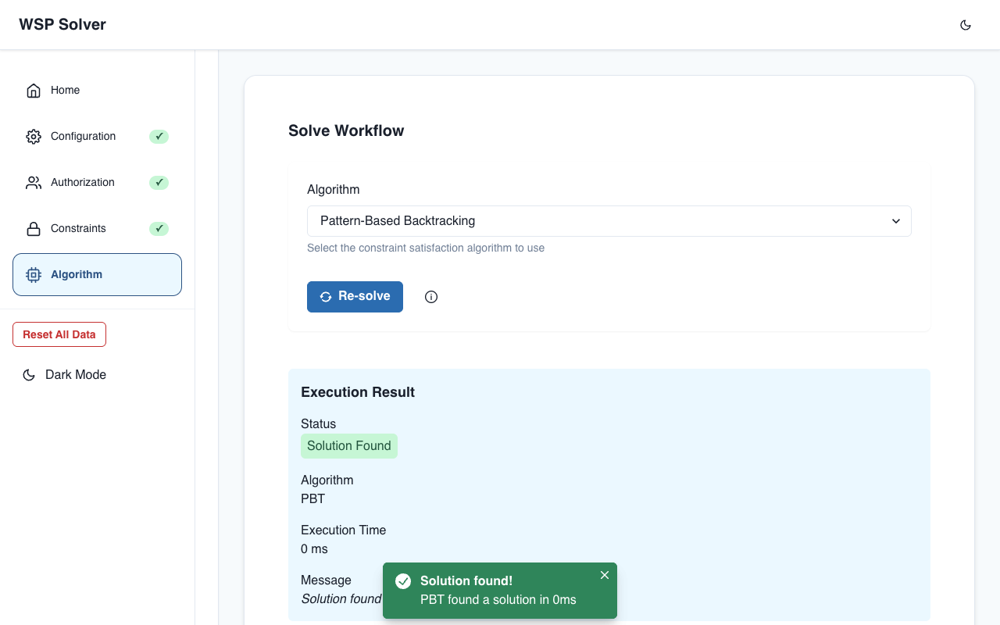

# WSP Solver

[](https://github.com/yas789/wsp-backtracker/actions/workflows/ci.yml)
[](LICENSE)

A solver and web interface for the Workflow Satisfiability Problem (WSP): can every step of a workflow be assigned to an authorised user while respecting separation-of-duty and binding-of-duty rules?

It solves the same problem four ways so they can be compared: plain backtracking, pattern-based backtracking, and CSP and SAT encodings using Google OR-Tools.



## The problem

Given a set of steps, a set of users and a matrix of who may perform each step, assign every step to one authorised user so that:

- **Must-same** (binding of duty): two steps go to the same user.
- **Must-different** (separation of duty): two steps go to different users.

## Solvers

| Solver | Approach |
|---|---|
| Backtracking | Assigns steps one at a time and undoes any assignment that breaks a constraint. |
| PBT | Enumerates the valid groupings of steps, then uses bipartite matching to give each group a user. Exponential only in the number of steps, not users. |
| CSP | Models each step as an integer variable in OR-Tools CP-SAT. |
| SAT | Models each step-user pair as a Boolean variable in OR-Tools CP-SAT. |

A test checks that all four agree on 300 seeded random instances and that every assignment they return is valid.

## Benchmarks

Time for each solver to find one assignment, or prove there is none, on 200 random instances with 5 or 10 users. All four agreed on all 200, of which 125 were satisfiable.

| Steps | Backtracking | PBT | CSP | SAT |
|---|---|---|---|---|
| 4 | 0.00 / 0.01 | 0.02 / 0.08 | 1.71 / 2.60 | 1.85 / 2.98 |
| 6 | 0.00 / 0.18 | 0.04 / 32.10 | 1.13 / 3.70 | 1.47 / 4.32 |
| 8 | 0.01 / 15.83 | 0.11 / 4.18 | 0.73 / 6.35 | 1.05 / 3.35 |
| 10 | 0.01 / 8.10 | 0.28 / 230.26 | 1.01 / 11.91 | 1.52 / 9.62 |
| 12 | 0.02 / 1167.91 | 0.81 / 986.73 | 0.30 / 10.73 | 1.21 / 4.83 |

*Median / worst time in milliseconds, from a single run on an Apple M1 with 8 GB of memory.*

Backtracking is fastest on a typical instance, but its worst case grows sharply. CSP and SAT cost a little more up front and stay predictable. These instances are too small to show PBT's advantage when there are many users, and it currently generates every grouping before checking any, which accounts for its slow worst cases.

To reproduce:

```bash
mvn -q compile exec:java -Dexec.mainClass=WSP.BenchmarkRunner
```

This prints the medians and writes every measurement to `results.csv`.

## Run it

You need Java 17+, Maven and Node.js 20+.

```bash
./run.sh
```

This starts the API on `http://localhost:8080` and the web interface on `http://localhost:3000`.

## Test it

```bash
mvn test                  # backend
cd frontend && npm test   # frontend
```

## API

`POST /api/solve`

```json
{
  "numSteps": 3,
  "numUsers": 2,
  "authorized": [[1, 1], [1, 1], [1, 1]],
  "mustSameConstraints": [{ "step1": 1, "step2": 2 }],
  "mustDifferentConstraints": [{ "step1": 0, "step2": 1 }],
  "solverType": "PBT"
}
```

`solverType` can be `SAT`, `CSP`, `BACKTRACKING` or `PBT`. Steps and users are numbered from 0.

```json
{
  "solutionFound": true,
  "assignment": [1, 0, 0],
  "message": "Solution found successfully",
  "solvingTimeMs": 0,
  "solverUsed": "PBT"
}
```

## Project layout

```
src/main/java/WSP/            Solvers and benchmark
src/main/java/com/fyp/wspapi/ Spring Boot API
frontend/                     React and Chakra UI interface
FYP/                          Original final-year project code
```

## License

[MIT](LICENSE)
